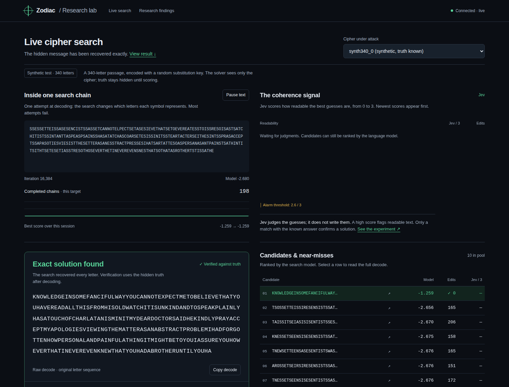

# zodiac

An autoresearch loop pointed at the two unsolved Zodiac killer
ciphers, with a live demo of the solver at work.



The demo streams a real run of the research solver. The page shows one
annealing chain turn gibberish into text, the candidate pool ranked by a
frozen language model, and the moment the exact solution is verified
against known truth.

## What is here

| Path | Contents |
| --- | --- |
| `zodiac-autoresearch/` | The experiment loop: solver, frozen cipher data, program, experiment log |
| `zodiac-demo/` | Live demo server and page (the screenshot above) |
| `farnese-letter.md` | Study of Simon Klee's 2026 break of a 1542 papal cipher, the method this project borrows |
| `zodiac-autoresearch-plan.md` | The plan for the loop |
| `zodiac-ciphers-report.md` | Checked facts on all four Zodiac ciphers |

## The problem

The Zodiac killer sent four ciphers to Bay Area newspapers in 1969 and
1970. Two are solved: Z408 (the Hardens, August 1969) and Z340
(Oranchak, Blake, and Van Eycke; FBI confirmed, December 2020). Two are
not: Z13, with 13 characters, and Z32, with 32.

Both unsolved ciphers sit at or below the unicity distance of a
homophonic substitution cipher — roughly 20 to 30 characters. At that
length, hundreds of readings fit the cipher equally well. No test can
single out the true one from letter statistics alone. So the loop's
success criterion for Z13 and Z32 is a measured ensemble of near-best
decodes, not a claimed name.

## What the loop found

The phase 5 report (`zodiac-autoresearch/ENSEMBLE.md`) enumerates the
near-best decodes exactly, with A* search under the frozen five-gram
model:

- **Z13 has no dominant reading.** Within 4 nats of the best score
  there are 52 distinct readings; within 8 nats, 1007. The set grows
  faster at each step. The ambiguity is a property of the cipher, not
  of the search — the enumeration is exact.
- **Z32 has one dominant reading**, 3.44 nats clear of the field. It
  reads `...SAN FRANC[ISCO]... CALIF[ORNIA]... PLEASE RUSH TO
  EDITOR...` in rotation. The model's corpus contains exactly this
  newspaper phrasing, so this is agreement between the model and a
  public hypothesis, not a confirmation.
- Together the two ciphers bracket the unicity distance from both
  sides: at 13 characters the near-best set explodes; at 32 characters
  the model commits to one reading.

The full experiment log is `zodiac-autoresearch/NOTES.md`.

## Run the demo

```
python3 zodiac-demo/server.py
```

Then open `http://localhost:8408`. The server imports the research
solver read-only and streams the search over Server-Sent Events. Set
`TYPESAFE_API_KEY` in the environment to let Jev score the readability
of candidates live. Without the key, the coherence panel shows the
alarm threshold only.

## Run one experiment

```
cd zodiac-autoresearch
python3 solve.py
```

The script prints `synth_score`, `z340_gap`, and `recovered`. One run
costs about five minutes at the default budget. Use
`ZODIAC_BUDGET=30 python3 solve.py` for a quick check.

See `zodiac-autoresearch/README.md` to run the full loop with Ralph in
Claude Code.

## Data integrity

`zodiac-autoresearch/ciphers.py` asserts the published symbol counts on
import: Z340 340 characters and 63 symbols, Z408 408 and 54, Z13 13 and
8, Z32 32 and 29. Provenance and cross-checks are documented in
`zodiac-autoresearch/data/sources.md`.
